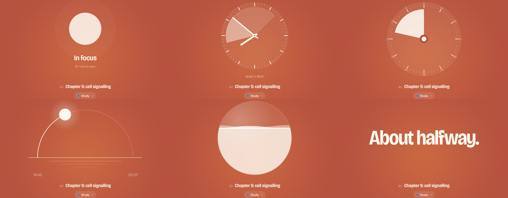
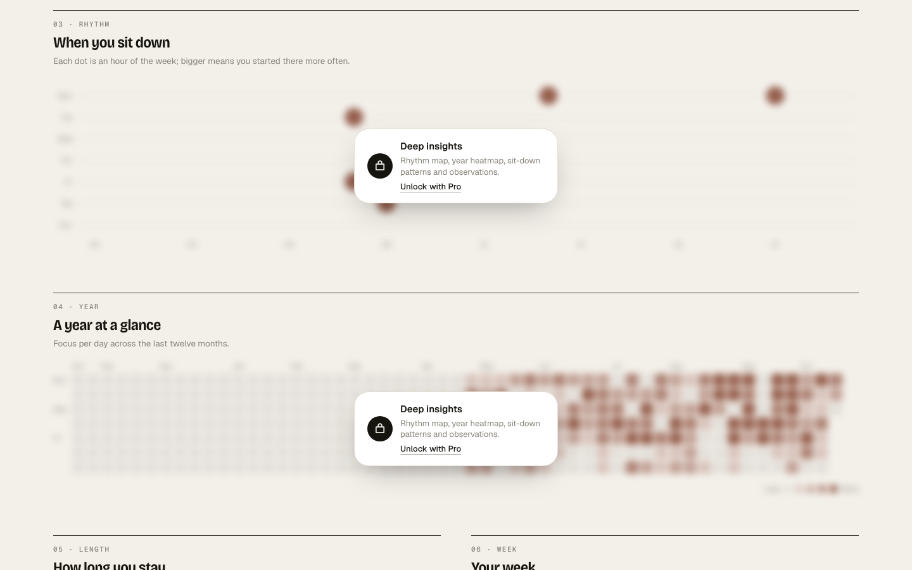

# Cadence

A focus timer you can hide, with clock faces that don't tick and an Insights page that shows how often you actually sit down to work. Built as the first module of a larger personal platform (wellness and fitness are next).


## What's in it

**Focus timer (Pomodoro, plus more)**

- Focus, short break and long break with your own lengths and long-break interval
- Auto-start breaks and focus, `+1 minute` while running, round counter, finish-time estimate
- Tasks with estimated and completed sessions, notes, drag to reorder, auto-tick and auto-advance
- Activities (Study, Work, Reading, your own) so every session is logged to a kind of work
- Daily goal ring, desktop notifications, a heads-up a few minutes before the end
- Synthesised alarm sounds and ambient soundscapes (clock tick, brown/pink/white noise, rain, ocean). No audio files.
- Six colour themes that shift per mode, optional dimming while running
- Zen mode, pop-out mini timer (Document Picture-in-Picture), keyboard shortcuts (`?` lists them)

**Time without a ticker**

- **Hide the timer** (`H`): a slow breathing orb replaces the numbers, the tab title says "In focus" instead of the time, and the progress bar disappears. Hold _peek_ if you must.
- **Faces** that show time passing without counting seconds: a wall clock with your session painted on the dial, a ring that tells you when it ends, a shrinking dial, a sun crossing the sky, a draining tide, a one-dot-per-minute grid, and plain words ("settling in", "about halfway").



**Insights**

Back-to-back sessions are grouped into **sit-downs** (sessions less than 20 minutes apart count as one sitting), so the numbers match how your day felt.

- Focused time, sit-downs, average sit-down length, active days and streaks, with change against the previous period
- Focus over time stacked by activity, and the activity mix
- When you sit down: a weekday × hour map of sit-down starts
- A year heatmap, sit-down length distribution, weekday averages, hours of the day, a 16-week trend
- Written observations from your own numbers (best weekday, peak hours, typical start time and how much it varies, late-night sessions, trend, completion rate)
- Session log with edit, delete and undo; log time you did away from the timer
- Every chart has a table view; CSV export


## Free and Pro

The timer is free. Pro is for depth. The full matrix lives in [`src/core/billing/plans.ts`](src/core/billing/plans.ts) and drives both the paywall and the pricing page.

|                                                       | Free                     | Pro          |
| ----------------------------------------------------- | ------------------------ | ------------ |
| Timer, tasks, hide timer, notifications, zen          | ✓                        | ✓            |
| Faces                                                 | Digits, ring, wall clock | All 8        |
| Flow mode (open-ended stopwatch, proportional breaks) |                          | ✓            |
| Activities                                            | 3                        | Unlimited    |
| Projects and task templates                           |                          | ✓            |
| Insights history                                      | 7 days                   | Everything   |
| Rhythm map, year heatmap, distributions, observations |                          | ✓            |
| Sounds and themes                                     | Basic                    | Full library |
| Pop-out timer, CSV export, cloud sync                 |                          | ✓            |

Locked charts render blurred behind an unlock card, so free users can see what they would get:



## Running it

Requires Node 20.9 or newer.

```bash
npm install
cp .env.example .env.local
npm run dev            # http://localhost:3000
```

With the example env file Cadence runs in **local mode**: no accounts, everything stored in the browser, and a **Demo Pro** switch on the Account page so you can try every Pro feature. Set `NEXT_PUBLIC_ALLOW_DEMO_PRO=false` in production.

| Script                        | What it does                               |
| ----------------------------- | ------------------------------------------ |
| `npm run dev`                 | Development server                         |
| `npm run build` / `npm start` | Production build and server                |
| `npm test`                    | Unit tests (analytics and timer logic)     |
| `npm run typecheck`           | TypeScript                                 |
| `npm run format`              | Prettier                                   |
| `npm run check`               | Typecheck, tests and format check together |

## Turning on accounts, sync and payments

Each step is optional and the app keeps working without the ones you skip.

### 1. Supabase (accounts and cloud sync)

1. Create a project at [supabase.com](https://supabase.com).
2. Run [`supabase/migrations/0001_init.sql`](supabase/migrations/0001_init.sql) in the SQL editor. It creates `profiles` (plan and billing state) and one generic `records` table that every module syncs into, with row-level security. Writes to `records` require an active Pro plan, enforced in the database, not just the UI.
3. Under Authentication, enable Email (magic link) and optionally Google, and add `https://your-domain/auth/callback` to the redirect URLs.
4. Set `NEXT_PUBLIC_SUPABASE_URL`, `NEXT_PUBLIC_SUPABASE_ANON_KEY` and `SUPABASE_SERVICE_ROLE_KEY`.

Docs: [Supabase Auth with Next.js](https://supabase.com/docs/guides/auth/server-side/nextjs), [Row Level Security](https://supabase.com/docs/guides/database/postgres/row-level-security).

### 2. Stripe (Pro subscriptions)

1. Create a product "Cadence Pro" with a monthly and a yearly recurring price. Put the price IDs in `STRIPE_PRICE_PRO_MONTHLY` and `STRIPE_PRICE_PRO_YEARLY`.
2. Add a webhook endpoint at `https://your-domain/api/billing/webhook` for `checkout.session.completed`, `customer.subscription.created`, `customer.subscription.updated` and `customer.subscription.deleted`. Put its signing secret in `STRIPE_WEBHOOK_SECRET`.
3. Enable the [customer portal](https://docs.stripe.com/customer-management) so people can cancel or change cards.
4. Set `STRIPE_SECRET_KEY` and `NEXT_PUBLIC_BILLING_ENABLED=true`.

Locally you can forward webhooks with `stripe listen --forward-to localhost:3000/api/billing/webhook` ([Stripe CLI](https://docs.stripe.com/stripe-cli)).

The flow: _Upgrade_ → `POST /api/billing/checkout` creates a Checkout Session for the signed-in user → Stripe calls the webhook → the webhook sets `profiles.plan = 'pro'` with the service role → the app reads the plan and unlocks Pro (and the database starts accepting sync writes).

### 3. Deploy

Any Node host works ([Next.js deploying guide](https://nextjs.org/docs/app/getting-started/deploying)). On Vercel: import the repository, add the environment variables, deploy. Remember to update `NEXT_PUBLIC_SITE_URL` and the Supabase redirect URL to the production domain.

## How it's built

Next.js 16 (App Router) · React 19 · TypeScript · Tailwind CSS 4 · Zustand · Supabase · Stripe · Phosphor icons · Bricolage Grotesque, Geist and Geist Mono (self-hosted via Fontsource). Charts are hand-written SVG.

```
src/
├─ app/                     Routes. Thin: each page renders a module view.
│  ├─ (app)/                Everything inside the app shell (nav, dialogs)
│  ├─ api/billing/          Stripe checkout, portal, webhook
│  └─ auth/callback/        Supabase sign-in callback
├─ core/                    Shared platform pieces, no module knowledge
│  ├─ data/                 Collections, documents, the shared timeline, sync, backup
│  ├─ billing/              Plans, entitlements, paywall UI, Stripe helpers
│  ├─ auth/                 Supabase clients and auth state
│  ├─ shell/                App shell, top bar, mobile nav, coming-soon page
│  ├─ theme/                Themes and per-mode colour variables
│  ├─ ui/                   Buttons, dialogs, popovers, fields, toasts
│  └─ lib/                  Time, dates, ids, notifications
├─ modules/
│  ├─ registry.ts           Navigation order of modules
│  ├─ focus/                Timer engine, tasks, faces, sounds, settings
│  ├─ insights/             Pure analytics functions, sample data, charts
│  ├─ account/              Sign-in and account pages
│  ├─ wellness/             Manifest only (coming soon)
│  └─ fitness/              Manifest only (coming soon)
└─ proxy.ts                 Refreshes auth cookies (Next 16's renamed middleware)
```

**Key ideas**

- **Local-first.** Every store persists to `localStorage` and works offline. Sync is an add-on, not a requirement.
- **One timeline.** Every block of time is an `Entry` in [`core/data/entries.ts`](src/core/data/entries.ts) with a `module` and `kind`. Focus writes `focus` and `break` entries; wellness and fitness will write their own kinds into the same timeline, and Insights can read across all of them.
- **Generic sync.** Collections created with `createCollection()` or `createDocument()` register themselves with the sync engine, which pushes and pulls last-write-wins records against a single `records` table. A new module gets sync, backup and restore without a migration.
- **Time is derived, never counted down.** The timer stores when it started and how much ran before pauses; remaining time is computed from the clock, so background-tab throttling and reloads can't make it drift.
- **Entitlements in one place.** UI asks `useCan("feature")`; the database enforces the one thing that must not be bypassed (sync writes).

Adding wellness or fitness: see [`docs/adding-a-module.md`](docs/adding-a-module.md).

## Keyboard

| Key         | Action                         |
| ----------- | ------------------------------ |
| `Space`     | Start / pause                  |
| `S`         | Skip to next segment           |
| `R`         | Reset segment                  |
| `H`         | Hide / show timer              |
| `F`         | Choose a face                  |
| `Z`         | Zen mode                       |
| `1` `2` `3` | Focus, short break, long break |
| `N`         | New task                       |
| `+`         | Add a minute                   |
| `?`         | All shortcuts                  |

## Mobile


