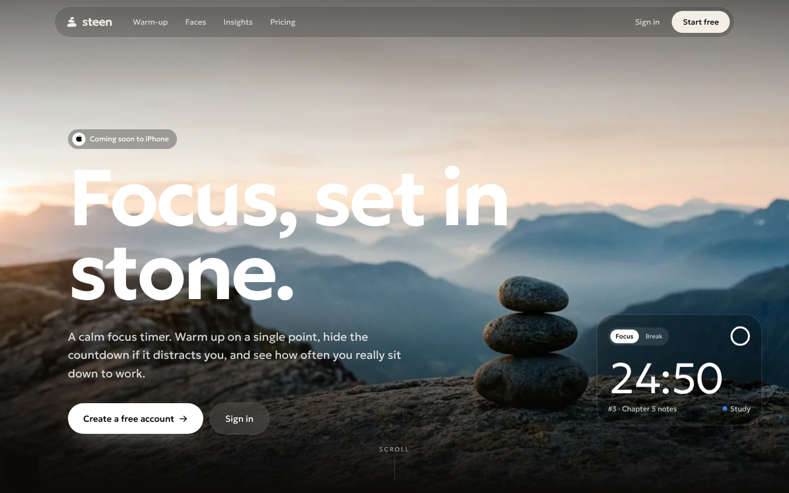
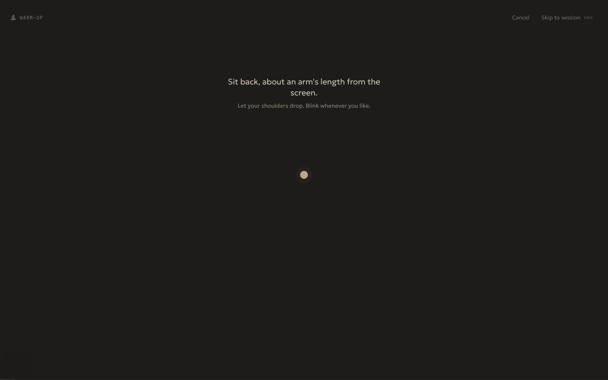
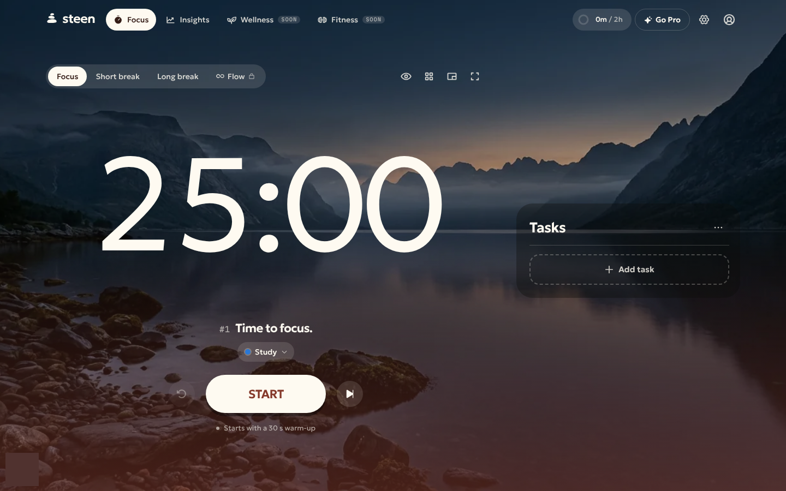
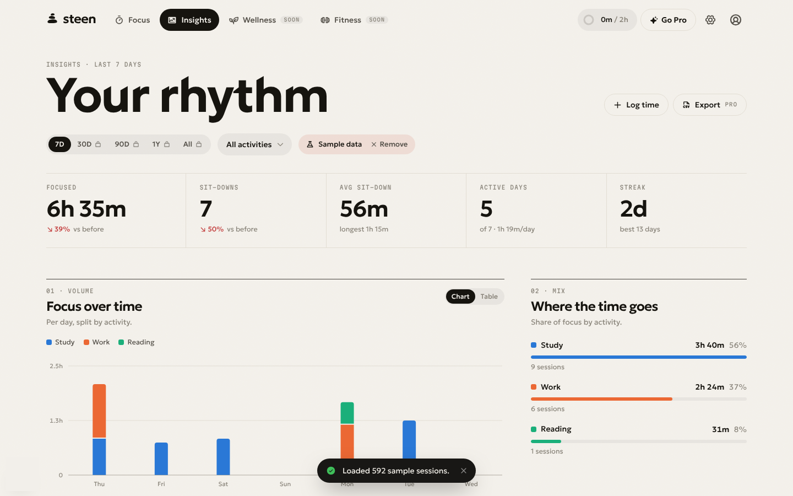
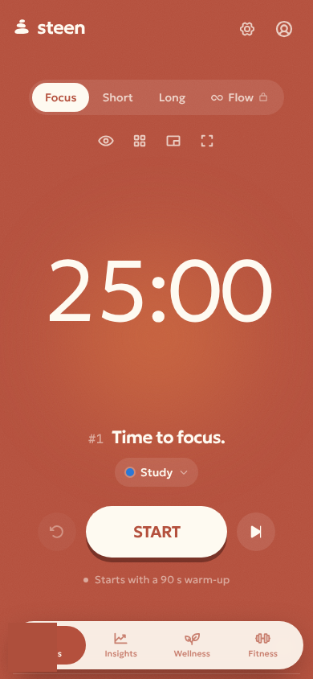

# Steen

**Focus, set in stone.** A calm focus timer: warm up on a single point before you sit down, hide the countdown or pick a face that doesn't tick, and see how often you actually sit down to work. Built as the first module of a larger personal platform (wellness and fitness are next), with an iPhone app on the way.



## What's in it

**An account from the first minute**

- A welcome page and sign-in with Apple, Google or an email link. The app opens once you have a free account, and your sessions, tasks and settings are saved to it and follow you to every device.
- Sign out clears the browser; Account → Delete account ends any subscription and erases everything.

**The focus warm-up**

Before the first session of a sit-down, Steen asks for the first small thing you'll do, then dims to a single dot: settle, rest your eyes on it, close them while the afterglow fades, and a soft tone starts the session. 30 seconds to 3 minutes; 90 seconds by default.

It is inspired by trataka, a steady-gaze practice that small studies link to better attention and memory scores afterwards, and by implementation intentions, the best-supported way to get started. No study has tested a short on-screen dot before work, so the app presents it as a calm ritual and never as a proven boost. The protocol, its sources and the reasoning live in [`src/modules/focus/warmup/protocol.ts`](src/modules/focus/warmup/protocol.ts); Settings → Warm-up shows the references to users.



**Focus timer (Pomodoro, plus more)**

- Focus, short break and long break with your own lengths and long-break interval
- Auto-start breaks and focus, `+1 minute` while running, round counter, finish-time estimate
- Tasks with estimated and completed sessions, notes, drag to reorder, auto-tick and auto-advance
- Activities (Study, Work, Reading, your own) so every session is logged to a kind of work
- Daily goal ring, desktop notifications, a heads-up a few minutes before the end
- Synthesised alarm sounds and ambient soundscapes (clock tick, brown/pink/white noise, rain, ocean). No audio files.
- Six colour themes that shift per mode, six generated landscapes behind the timer, five typefaces
- Zen mode, pop-out mini timer (Document Picture-in-Picture), keyboard shortcuts (`?` lists them)



**Time without a ticker**

- **Hide the timer** (`H`, or the eye button): a slow breathing orb replaces the numbers, the tab title says "In focus" instead of the time, and the progress bar disappears. Hold _peek_ if you must.
- **Faces** that show time passing without counting seconds: a wall clock with your session painted on the dial, a ring that tells you when it ends, a shrinking dial, a sun crossing the sky, a draining tide, a one-dot-per-minute grid, and plain words ("settling in", "about halfway").

**Insights**

Back-to-back sessions are grouped into **sit-downs** (sessions less than 20 minutes apart count as one sitting), so the numbers match how your day felt.

- Focused time, sit-downs, average sit-down length, active days and streaks, with change against the previous period
- Focus over time stacked by activity, and the activity mix
- When you sit down: a weekday × hour map of sit-down starts
- A year heatmap, sit-down length distribution, weekday averages, hours of the day, a 16-week trend
- Written observations from your own numbers (best weekday, peak hours, typical start time, late-night sessions, trend, completion rate, and how long you stay after a warm-up against without one)
- Session log with edit, delete and undo; log time you did away from the timer
- Every chart has a table view; CSV export



## Free and Pro

The timer is free. Pro is for depth. The full matrix lives in [`src/core/billing/plans.ts`](src/core/billing/plans.ts) and drives both the paywall and the pricing page.

|                                                       | Free                     | Pro          |
| ----------------------------------------------------- | ------------------------ | ------------ |
| Timer, warm-up, tasks, hide timer, notifications, zen | ✓                        | ✓            |
| Saved to your account, on every device                | ✓                        | ✓            |
| Faces                                                 | Digits, ring, wall clock | All 8        |
| Landscapes behind the timer                           | 2                        | All 6        |
| Flow mode (open-ended stopwatch, proportional breaks) |                          | ✓            |
| Activities                                            | 3                        | Unlimited    |
| Projects and task templates                           |                          | ✓            |
| Insights history                                      | 7 days                   | Everything   |
| Rhythm map, year heatmap, distributions, observations |                          | ✓            |
| Sounds and themes                                     | Basic                    | Full library |
| Pop-out timer, CSV export                             |                          | ✓            |

Locked charts render blurred behind an unlock card, so free users can see what they would get.

## Running it

Requires Node 20.9 or newer.

```bash
npm install
cp .env.example .env.local
npm run dev            # http://localhost:3000
```

With the example env file Steen runs in **local mode**: no accounts, no sign-in wall, everything stored in the browser, and a **Demo Pro** switch on the Account page so you can try every Pro feature. Set `NEXT_PUBLIC_ALLOW_DEMO_PRO=false` in production.

| Script                        | What it does                                           |
| ----------------------------- | ------------------------------------------------------ |
| `npm run dev`                 | Development server                                     |
| `npm run build` / `npm start` | Apply database migrations, build, serve                |
| `npm run migrate`             | Apply database migrations only                         |
| `npm test`                    | Unit tests (analytics, timer, warm-up, Stripe webhook) |
| `npm run typecheck`           | TypeScript                                             |
| `npm run format`              | Prettier                                               |
| `npm run check`               | Typecheck, tests and format check together             |

## Launching it

**[docs/launch.md](docs/launch.md)** walks through it step by step: putting the site online with Vercel, accounts with Supabase, Google, Apple and email sign-in, becoming admin, setting up the Stripe paywall in test mode, and going live (domain, VAT, legal pages). Signed in as admin, **/admin** shows a launch checklist of what is configured and what isn't.

In short:

| Piece             | Service                                                                                      | What it unlocks                                                 |
| ----------------- | -------------------------------------------------------------------------------------------- | --------------------------------------------------------------- |
| Hosting           | Vercel (from this GitHub repo)                                                               | Public URL, auto-deploy on every push                           |
| Accounts and data | Supabase (tables are created by the build from [`supabase/migrations`](supabase/migrations)) | Sign-in, saved data, admin                                      |
| Payments          | Stripe                                                                                       | Checkout, customer portal, webhook that switches Pro on and off |

**Giving friends Pro.** Put your email in `ADMIN_EMAILS`, sign in, and open **/admin**; admins get Pro for life automatically. Enter any email with an end date or "forever"; it works even before they sign up. Pro is "paying subscription OR active gift", checked both in the app and in the database.

The payment flow: _Upgrade_ → `POST /api/billing/checkout` creates a Checkout Session for the signed-in user → Stripe calls `/api/billing/webhook` → the webhook reads the subscription's current state and sets `profiles.plan` → the app unlocks Pro. The webhook verifies Stripe's signature and is covered by tests.

## How it's built

Next.js 16 (App Router) · React 19 · TypeScript · Tailwind CSS 4 · Zustand · Motion · Lenis · Supabase · Stripe · Phosphor icons · Geologica and Martian Mono, plus four optional typefaces (self-hosted via Fontsource). Charts are hand-written SVG; landscapes are generated and served as WebP.

```
src/
├─ app/                     Routes. Thin: each page renders a module view.
│  ├─ (app)/                Everything inside the app shell (nav, dialogs)
│  ├─ (site)/               Welcome, sign-in, pricing and legal pages (night design)
│  ├─ api/billing/          Stripe checkout, portal, webhook
│  ├─ api/account/          Account deletion
│  ├─ api/admin/            Admin-only: members, Pro gifts, launch checklist
│  └─ auth/callback/        Supabase sign-in callback
├─ core/                    Shared platform pieces, no module knowledge
│  ├─ data/                 Collections, documents, the shared timeline, sync, backup
│  ├─ billing/              Plans, entitlements, paywall UI, Stripe helpers
│  ├─ auth/                 Supabase clients and auth state
│  ├─ shell/                App shell, top bar, mobile nav, coming-soon page
│  ├─ theme/                Themes and per-mode colour variables
│  ├─ ui/                   Buttons, dialogs, popovers, fields, toasts
│  └─ lib/                  Time, dates, ids, notifications
├─ modules/
│  ├─ registry.ts           Navigation order of modules
│  ├─ focus/                Timer engine, warm-up, tasks, faces, sounds, settings
│  ├─ site/                 Landing page sections, sign-in screen, smooth-scroll helpers
│  ├─ insights/             Pure analytics functions, sample data, charts
│  ├─ account/              Account page
│  ├─ admin/                Owner-only members page (gift Pro)
│  ├─ wellness/             Manifest only (coming soon)
│  └─ fitness/              Manifest only (coming soon)
└─ proxy.ts                 Refreshes auth cookies and keeps the app behind sign-in (Next 16's middleware)
```

**Key ideas**

- **Local-first, account-backed.** Every store persists to `localStorage` and works offline, then syncs to the signed-in account. Local data belongs to one account: signing in as someone else clears it first.
- **One timeline.** Every block of time is an `Entry` in [`core/data/entries.ts`](src/core/data/entries.ts) with a `module` and `kind`. Focus writes `focus` and `break` entries; wellness and fitness will write their own kinds into the same timeline, and Insights can read across all of them.
- **Generic sync.** Collections created with `createCollection()` or `createDocument()` register themselves with the sync engine, which pushes and pulls last-write-wins records against a single `records` table. A new module gets sync, backup and restore without a migration.
- **Time is derived, never counted down.** The timer stores when it started and how much ran before pauses; remaining time is computed from the clock, so background-tab throttling and reloads can't make it drift.
- **Entitlements in one place.** UI asks `useCan("feature")`; row-level security makes sure people can only read and write their own rows and never change their own plan.

Adding wellness or fitness: see [`docs/adding-a-module.md`](docs/adding-a-module.md).

## Keyboard

| Key         | Action                         |
| ----------- | ------------------------------ |
| `Space`     | Start (with warm-up) / pause   |
| `S`         | Skip to next segment           |
| `R`         | Reset segment                  |
| `H`         | Hide / show timer              |
| `F`         | Choose a face                  |
| `Z`         | Zen mode                       |
| `1` `2` `3` | Focus, short break, long break |
| `N`         | New task                       |
| `+`         | Add a minute                   |
| `Esc`       | Skip the warm-up and start     |
| `?`         | All shortcuts                  |

## Mobile

Steen works in mobile browsers and can be added to the home screen (Safari → Share → Add to Home Screen). A native iPhone app is planned.


